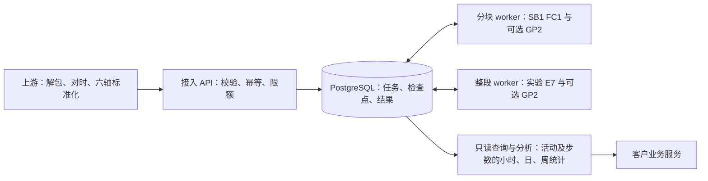

# IMU 推理与分析服务

**服务 1.1.0 · 推理库 1.0.0 · HTTP v2 · Linux x86_64 CPU**

将标准化胸前 IMU 数据转成四类活动时间线、累计时长和实验性计步结果。包含持久队列、分块／整段计算、查询与小时／日／周分析。1.1.0 新增日历计步，不更换模型。

## 交接入口

| 任务 | 阅读材料 |
|---|---|
| 安装、启动、更新和恢复 | [部署与运维](docs/operations.md) |
| 上传、查询、统计活动和步数 | [接口指南](docs/api.md)、[调用示例](examples/) |
| 模型、训练数据和验证结果 | [模型与验证](https://github.com/Kscii/imu-inference/blob/main/docs/model.md)；离线位置 `imu-inference/docs/model.md` |
| 审查软件验证 | [验证入口](reports/README.md)、发布包 manifest.json |

## 快速运行

在完整离线交付包根目录执行：

```bash
sha256sum -c SHA256SUMS
docker load -i imu-images-1.1.0.tar.gz
cd imu-services
python3 scripts/create_env.py
docker compose -f compose.yaml -f compose.offline.yaml up -d --wait
python3 scripts/smoke_http.py
```

`.env` 仅本地生成，不提交 Git。回放使用 150 秒合成六轴信号，两种模式均应报告 149 秒有效观测；它检查服务功能，不证明准确率。真实调用见接口指南。

开发构建使用 Python 3.12、uv 和 Docker：

```bash
uv sync --frozen --extra worker
docker build --target runtime -t localhost/imu-runtime:1.1.0 .
docker build --target query -t localhost/imu-query:1.1.0 .
```

## 结构与责任



上游提供 25 Hz 六轴、缺失掩码和带时区起点，保留原始记录并管理人员归属。本服务不解设备原始包、不推断未观测时间、不提供诊断或独立可靠的走跑分类。终态清理服务输入，重算依赖上游重传。

Compose 提供单机恢复与有限队列；生产 TLS、备份目的地、跨机高可用和设备联调由接收环境落实。API/query 默认只绑定本机回环地址。

## 源码与制品

`src/` 是完整服务实现，`tests/`、`scripts/`、`operations/` 用于验证、打包与运维，`vendor/wheels/` 固定已验收推理库。模型与算法源码在私有 `Kscii/imu-inference` 仓库。

Release 提供离线包与摘要，GHCR 提供 runtime/query 镜像。原始数据和完整训练研究工程不在交付范围；正式源码起点见 [来源清单](provenance/delivery-origin.json)，第三方声明随推理库保留。

工程验证、研究参考效果和客户准确率验收分别记录。现有参考数据不是独立客户盲测，软件发布不代表新客户达到 80%。
