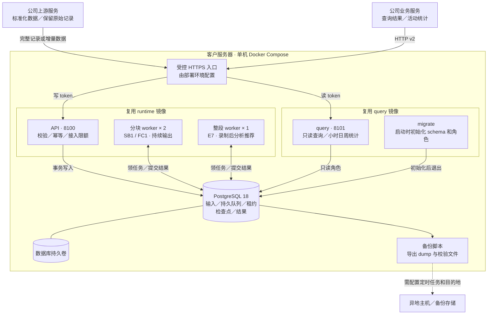
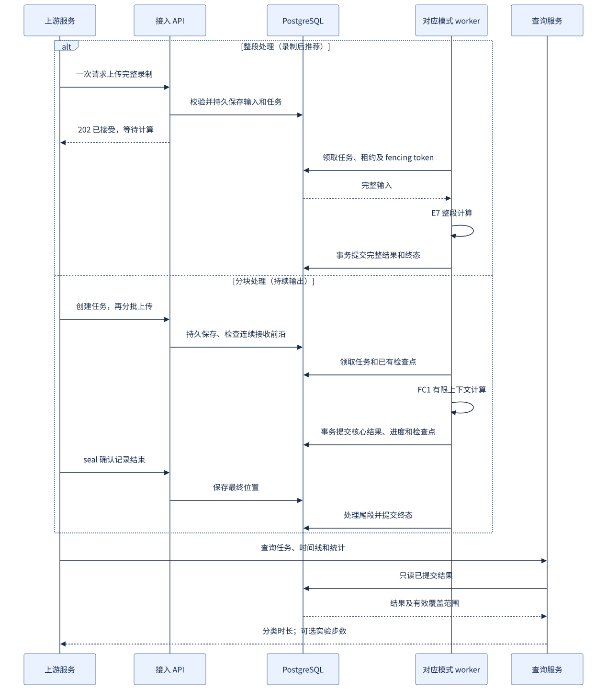
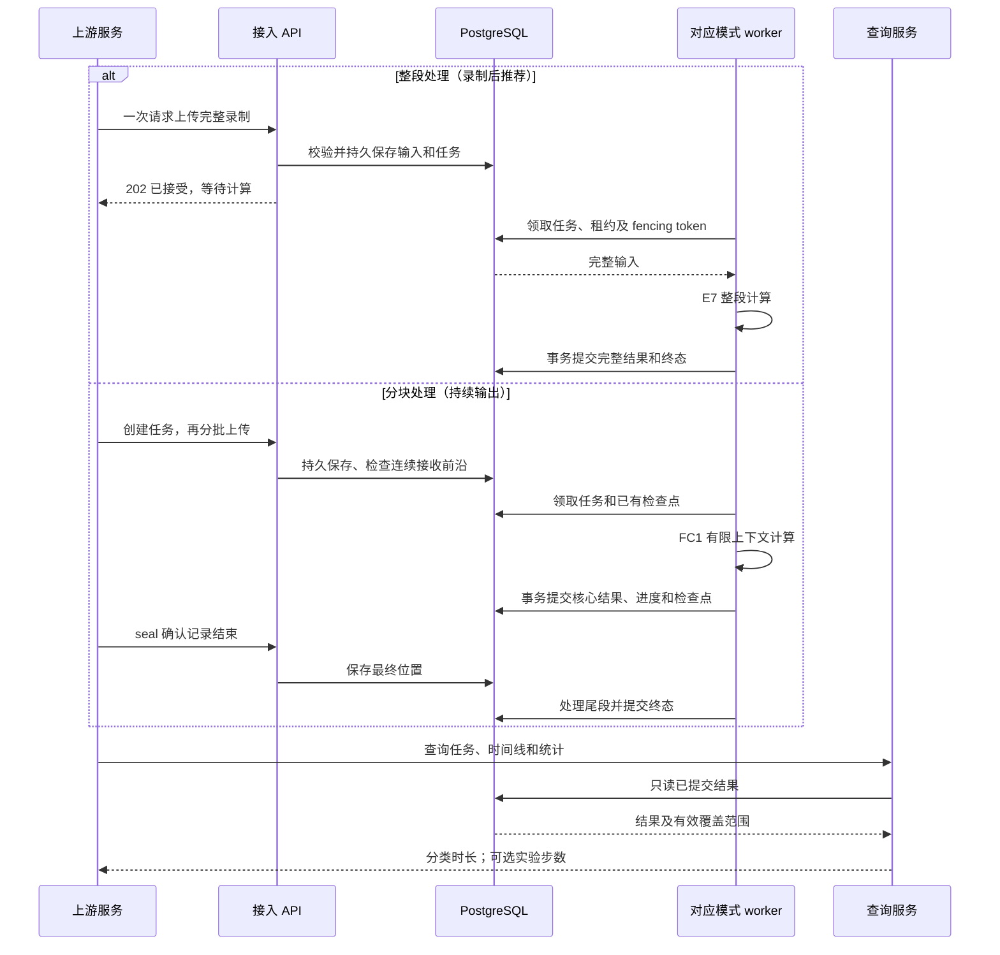
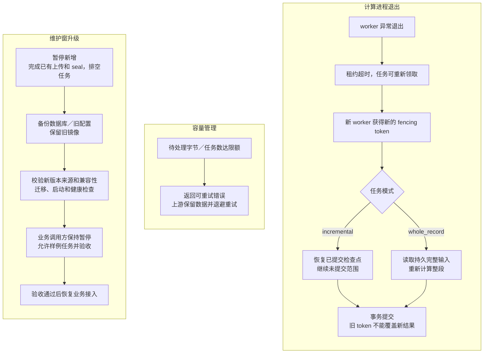

# 服务架构与数据流

服务 1.1.1、推理库 1.0.1、HTTP v2、数据库 schema 2。标准输入为规范胸前佩戴的 25 Hz 六轴及掩码；模型计算细节见推理库模型手册。一个任务在创建时确定计算模式、模型及配置，已开始任务不热换模型。

## 先看数据如何流动

[打开原尺寸图](diagrams/overview.svg) · [Mermaid 源文件](diagrams/overview.mmd)

1. 上游通过接入 API 提交标准化 IMU 数据，服务把输入和任务持久保存到 PostgreSQL。
2. 计算进程领取任务，调用镜像内的模型与算法，再把结果写入数据库。
3. 调用方通过查询 API 读取状态、时间线和活动统计，不直接访问数据库。

PostgreSQL 是本服务的任务与结果数据库，可以与公司的设备原始数据库并存。上传请求被接受不等于计算完成；两个 API 的用途和读写 token 见[安装后的对接说明](../README.md#6-向公司其他服务提供调用入口)。

## 组件与镜像

| 镜像 | 启动的服务 | 作用 |
|---|---|---|
| runtime | `api`、`worker`、`worker-whole` | 接入及两类计算进程；包括模型和运行依赖 |
| query | `query`、`migrate` | 查询统计；初始化数据库结构和角色 |
| PostgreSQL | `postgres` | 保存任务、队列、检查点及结果 |

默认 2 个分块 worker、1 个整段 worker，各进程有资源限额；初始化任务完成后退出。数据库文件放在持久卷中，应用容器替换后数据仍可保留。运行时无需下载权重；不依赖独立 Redis。

## 单机部署拓扑

[打开原尺寸图](diagrams/deployment.svg) · [Mermaid 源文件](diagrams/deployment.mmd)

查看 Mermaid 源码

API 与 worker 复用 runtime 镜像，query 与初始化复用 query 镜像；两个镜像连同 PostgreSQL 构成完整部署。数据库不暴露宿主机端口，API/query 默认只绑定回环地址，受控跨机入口由客户配置 TLS。持久队列位于 PostgreSQL，不依赖单独 Redis 或消息队列基础设施。

## 接入、计算与查询

[打开原尺寸图](diagrams/request-flow.svg) · [Mermaid 源文件](diagrams/request-flow.mmd)

查看 Mermaid 源码

上传包长不决定算法上下文。分块模式正常累计 90 秒后发布首个 60 秒核心，后续每 60 秒推进；整段模式（录制结束后分析推荐）使用整条记录，上游可在录制结束时提交，不强制等自然日末。同一研究参考中 E7 整体分类准确性更高，但不保证每类时长都改善，见[指标比较](https://github.com/Kscii/imu-inference/blob/main/docs/model.md#分类和时长指标)。时区和日历统计按接口约定处理，缺失时间不会补成静止或零步。

## 恢复、过载与升级

[打开原尺寸图](diagrams/recovery-upgrade.svg) · [Mermaid 源文件](diagrams/recovery-upgrade.mmd)

查看 Mermaid 源码

不同模式有独立计算池和容量上限；不会因 whole_record 占用计算而改用分块模型。终态清理服务保存的输入，重算依赖上游重传；不宣称底层 WAL 或备份已经物理擦除。`restart` 处理进程退出，持续 unhealthy 仍需部署方监控。

本补丁的模型参数和计算不变，但库版本和代码摘要会改变任务指纹，不能接着恢复旧库检查点。单机内的持久队列可吸收短时突发，队列限额会拒绝超量请求，但不提供跨机高可用。容量、监控和备份操作见[运维说明](operations.md)。
