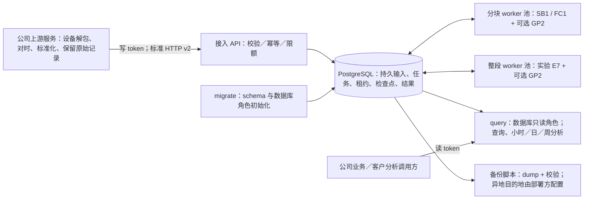
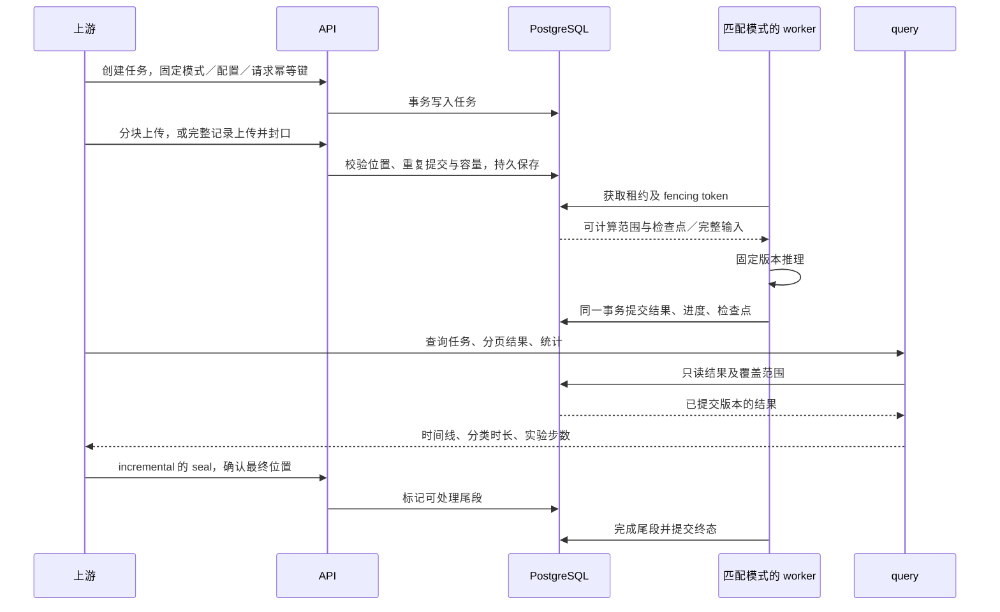
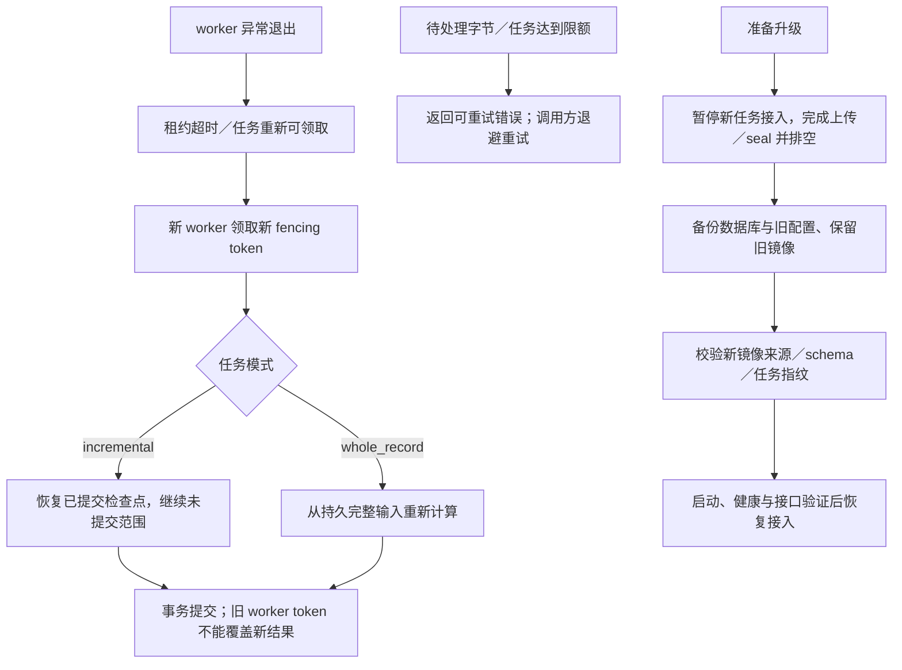

# 服务架构与数据流

服务 1.1.1、推理库 1.0.1、HTTP v2、数据库 schema 2。标准输入为规范胸前佩戴的 25 Hz 六轴及掩码；模型计算细节见推理库模型手册。一个任务在创建时确定计算模式、模型及配置，已开始任务不热换模型。

## 单机部署拓扑

API 与 worker 复用 runtime 镜像，query 与初始化复用 query 镜像；两个镜像连同 PostgreSQL 构成完整部署。数据库不暴露宿主机端口，API/query 默认只绑定回环地址，受控跨机入口由客户配置 TLS。持久队列位于 PostgreSQL，不依赖单独 Redis 或消息队列基础设施。

## 接入、计算与查询

上传包长不决定算法上下文。分块模式正常累计 90 秒后发布首个 60 秒核心，后续每 60 秒推进；完整模式使用整条记录，上游可在录制结束时提交，不强制等自然日末。时区和日历统计按接口约定处理，缺失时间不会补成静止或零步。

## 恢复、过载与升级

不同模式有独立计算池和容量上限；不会因 whole_record 占用计算而改用分块模型。终态清理服务保存的输入，重算依赖上游重传；不宣称底层 WAL 或备份已经物理擦除。`restart` 处理进程退出，持续 unhealthy 仍需部署方监控。

本补丁的模型参数和计算不变，但库版本和代码摘要会改变任务指纹，不能接着恢复旧库检查点。这里只交付单机可部署的软件及恢复机制，生产高可用、异地备份位置、报警接收方和客户负载容量需在接收环境落实。
